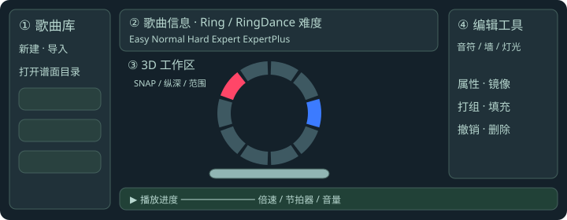
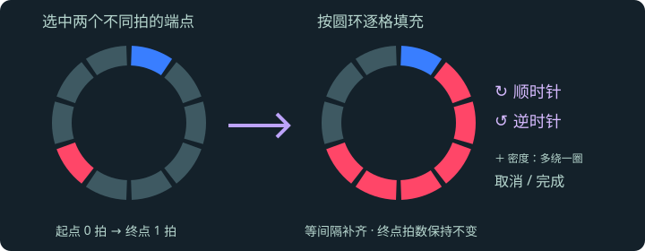
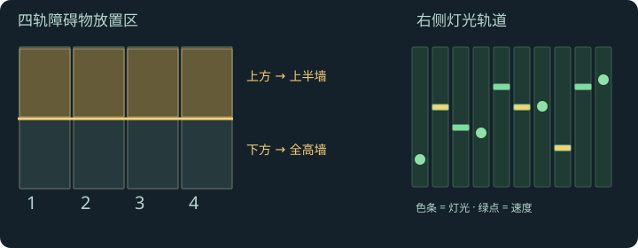
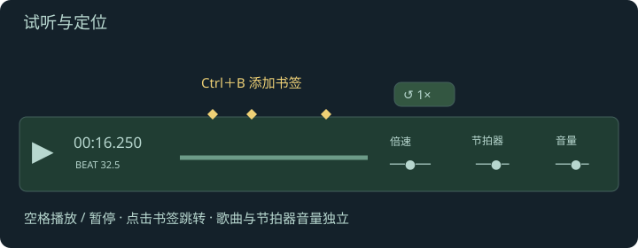

# 新手教程

右上角 **? 新手教程** 提供 8 个图文章节，可随时翻页或跳到指定章节。

## 1. 创建歌曲与难度

- 先点击 WORKSPACE 旁的“打开本地文件夹”，选择包含歌曲子目录的 Map 并授权读取。左侧选择已有歌曲；新曲点击“新建”，填写歌名、艺术家、BPM，并添加音频与封面。推荐 OGG 音频、512 × 512 PNG 封面。
- “导入”支持 ZIP 曲包或 YAML。歌曲信息右侧分为 Ring 和 RingDance，每类显示 Easy、Normal、Hard、Expert、ExpertPlus。
- 已有难度可切换；灰色难度的 **＋** 用于创建，可选择复制当前音符、墙或灯光。
- “打开本地文件夹”可重新选择目录，“刷新”重新扫描曲库。权限失效时点击“重新授权”。音乐、封面和谱面不上传；不支持目录读写的浏览器可导入和导出 ZIP。

## 2. 认识 3D 工作台

圆环有十个手部音符位置，下方是脚部踏板，右侧是灯光轨道。地面数字是拍号。

- 滚轮向上前进、向下后退歌曲进度；设置可反向。
- 右键拖动转动相机；WASD 平移。按住右键时 Shift 下降、空格上升。重置相机恢复居中俯视。
- SNAP 决定编辑步长，可选预设或输入分母；Ctrl＋滚轮切换预设。
- 纵深拉伸改变空间距离，预览范围改变可见拍数，都不改变实际节拍。默认值可在设置中填写。
- 底部“传统时间轴”可展开二维轨道，并缩小 3D 画布。

## 3. 放置手脚音符

按 **1** 进入音符类别，定位节拍后点击圆环或踏板放置。**Q** 切换放置颜色。新音符默认不选中。

鼠标指向脚部音符，按住 **Alt＋滚轮**，以当前 SNAP 加长或缩短。长度大于零自动转为长音符，缩到零变回短音符。脚部标号为 −18…−1、1…18，没有零。

设置中的手部、脚部不透明度可以分别调整或同步调整；只影响预览。选中标记保持清晰。

## 4. 选择、移动、删除

- 点击已有物体选中，点击空白处取消。音符类别也能选中墙。
- Shift＋点击多选，按住 Shift 时禁止放置。
- Alt＋左键拖动在 3D 中改变位置；传统时间轴拖动也可改变节拍。
- Del 优先删除选中项；无选中项时删除鼠标下物体。
- Ctrl＋C / V 复制、粘贴到播放头；Ctrl＋Z / Y 撤销、重做。
- Ctrl＋A 选中当前类别中视野内可见物体；“范围选取”可按节拍选更大范围。
- 左右、上下、对角镜像只改位置，保留颜色和击打方向；Ctrl＋F 为左右镜像。

## 5. 打组与填充

选中多个手部音符可在旁边“打组”，支持红蓝同组。组内首音符有圆圈标记，双击组员可选整组。已分组音符显示“取消组”；混合选择组内外音符时可“加入组”。

选两个不同拍的手部音符，点击旁边或工具栏的 **填充**。按时间确定起终点，逐格补齐并均匀安排节拍。可选顺时针、逆时针和密度；增加密度时自动多绕整圈，终点位置和节拍不变。

调整替换本次生成内容，保留已有占位。新增颜色沿用起点；两端同组时加入原组。当前列出最多新增 2048 个音符的方案。

**完成**保留结果；**取消**恢复填充前的谱面，撤回本次全部方向、密度调整，并保留填充前的撤销记录。

## 6. 墙与灯光

按 **2** 切换障碍物：前方四轨区域中，中线上方放上半墙，下方放全高墙；悬停先预览。新墙固定一轨宽和默认拍长。Alt 拖动换轨，Del 删除，墙仅支持左右镜像。

按 **3** 切换灯光：选择轨道与事件，在右侧轨道点击放置。绿黄条表示灯光，绿点和高度表示速度（0 静止、6 最快）。点击“灯光总览”方便观察；“轨道映射”可校准由本地样本推定的事件类型。

## 7. 试听与书签

空格播放暂停。点击歌曲信息中的“测 BPM”会播放歌曲，连续跟拍估算 BPM。倍速可连续调整，非 1× 时上方出现复位按钮。歌曲和节拍器有独立音量。

Ctrl＋B 在当前位置添加书签；书签常显于进度条，点击跳转。节拍整体错位应调整 BPM 或偏移量，不能用纵深拉伸代替校准。

## 8. 检查、保存、导出

点击“检查谱面”。若出现“beat X 上有错误音符”，点击提示定位并处理重叠。

Ctrl＋S 保存到本地。新曲首次保存需填写目录名；已有文件会先备份。导出 ZIP 包含歌曲信息、音符、灯光事件与资源。浏览器草稿只作辅助，仍需主动保存或导出。

建议先练习一小段：**放置 → 填充 → 试听 → 检查 → 保存**。

## 网站版的保存与恢复

保存需要允许浏览器修改所选文件夹。原文件先备份到 `Map/.ringmapper-backups/歌曲目录/时间戳/`，再写回谱面。若文件被外部修改，编辑器停止覆盖；请先导出 ZIP 保留当前编辑，再重新打开原文件。

浏览器草稿包含谱面和已导入资源，并绑定原工作区。刷新后可恢复；写回前需要重新授权对应目录。未授权时导出会明确提示仅含恢复内容，不包括原目录中尚未加载的音频或其他难度。不要仅依赖浏览器草稿保管作品。

## 内置示例与 RAR

初次打开会显示 Diabolic Swing（t+pazolite，谱师 Hancci_，Ring / Expert）示例，曲库中的示例卡片始终保留。可直接试听、编辑、导出 ZIP，或保存到自己的本地目录；网站原版不会被覆盖。

“导入”和歌曲设置中的“导入音频 / ZIP / RAR”均支持 RAR4、RAR5 单卷无密码压缩包，解压在浏览器本地线程中进行。加密或分卷包会显示说明；导出仍为 ZIP。
